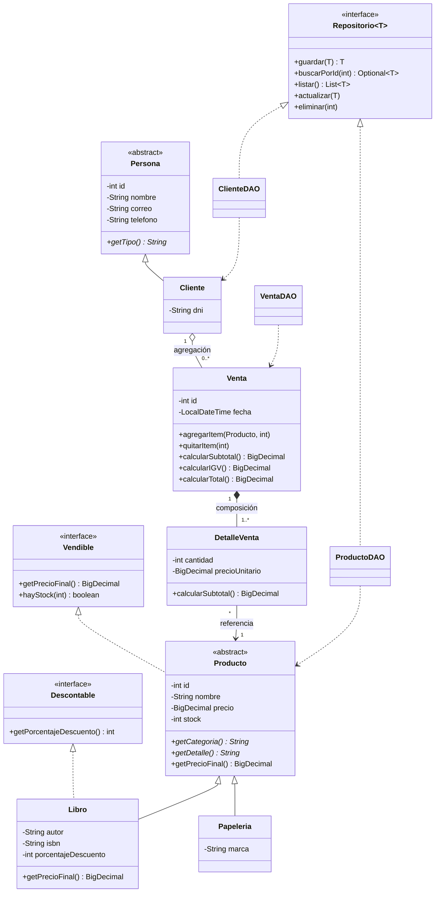

# Diagrama de clases (UML)

Se visualiza directamente en GitHub (Mermaid). Cubre herencia, clases abstractas, interfaces,
polimorfismo, agregación y composición.

## Capas del proyecto

| Paquete | Responsabilidad |
|---------|-----------------|
| `modelo` | Clases del dominio y sus reglas de negocio. |
| `excepcion` | Excepciones propias (datos inválidos, stock, persistencia). |
| `persistencia` | JDBC: conexión, CRUD y transacciones sobre H2. |
| `servicio` | Consultas con colecciones (`Reportes`). |
| `util` | Validaciones y manejo de archivos (CSV, boletas). |
| `vista` | Interfaz gráfica Swing (un panel por módulo). |
